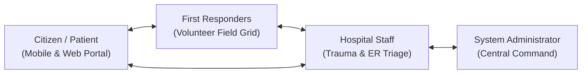

# Emergency Alert and Hospital Assistance System

### Full-Stack Healthcare SaaS Monorepo: Java Spring Boot Backend + React TypeScript Frontend + Mobile Clients + ESP32 Firmware

**Official Project Name:** Emergency Alert and Hospital Assistance System  
**Project Type:** Community Service Project (CSP)  
**Academic Programme:** Bachelor of Technology (B.Tech)  
**Institution:** Vasireddy Venkatadri Institute of Technology (VVIT), Guntur, Andhra Pradesh  
**Department:** Computer Science and Engineering  
**Batch:** Batch 8  
**Prepared by:** VSK (Reg. No: 24BQ1A054O)  
**Project Guide:** Mr. G. Lakshmi Narayana (Assistant Professor)  

**Live Production Deployments:**
- **Frontend Web App (Vercel):** [https://frontend-seven-zeta-99.vercel.app](https://frontend-seven-zeta-99.vercel.app)
- **Backend REST API (Render):** [https://emergency-alert-and-hospital-assistance.onrender.com](https://emergency-alert-and-hospital-assistance.onrender.com)
- **Interactive API Documentation (Swagger UI):** [https://emergency-alert-and-hospital-assistance.onrender.com/swagger-ui.html](https://emergency-alert-and-hospital-assistance.onrender.com/swagger-ui.html)

---

## 1. Executive Summary & Project Purpose

During acute medical crises and vehicular accidents, victims frequently suffer from critical communication latency when attempting to notify emergency transport teams and receiving hospitals. Trauma centers often receive casualties with zero advance notice, preventing emergency departments from pre-allocating surgical suites, intensive care beds, and cross-matched blood supplies.

The **Emergency Alert and Hospital Assistance System** establishes a real-time, synchronized emergency response network bridging four vital healthcare stakeholders:



$$\text{Citizen / Patient} \longleftrightarrow \text{First Responders} \longleftrightarrow \text{Hospital Staff} \longleftrightarrow \text{System Administrator}$$

---

## 2. Technical Architecture & Tech Stack

The platform is designed around a decoupled, secure client-server architecture with strict role-based access control (RBAC):

```text
ESP32 Firmware (IMU & BLE GATT) ──> Mobile App (Flutter / Android) ──> Spring Boot REST API ──> Cloud PostgreSQL (Port 5432)
                                                                               ▲
React Web App (Vite SaaS Portal) ──────────────────────────────────────────────┘
```

| Layer | Technologies & Frameworks | Description & Versioning |
| :--- | :--- | :--- |
| **Frontend Web App** | React 19, TypeScript, Tailwind CSS v4, Vite 8, Zustand, Lucide React, Leaflet, Recharts | Clinical-grade healthcare SaaS deployed on Vercel (`https://frontend-seven-zeta-99.vercel.app`) with Light/Dark themes and 4 role dashboards |
| **Backend REST API** | Java 21 LTS, Spring Boot 3.3.4, Spring Security, Spring Data JPA, JJWT 0.12.5, SpringDoc OpenAPI 2.6.0 | Stateless microservices, Haversine geospatial proximity engine, SSE streams deployed on Render |
| **Production Database** | Cloud PostgreSQL (Supabase IPv4 Session Pooler / Neon PostgreSQL via JDBC on port 5432 with SSL) | Relational persistence with normalized tables, Flyway migrations V1–V8 |
| **Development Database** | In-Memory H2 Database (`SPRING_PROFILES_ACTIVE=dev`) | Zero-config local development and integration testing |
| **Mobile Client** | Flutter 3 (Dart), Android Jetpack Compose (Kotlin), BLE GATT | Citizen emergency companion, offline emergency guide, and hardware telemetry bridge |
| **Hardware Firmware** | ESP32 C++/Arduino, MPU6050 6-axis IMU, BLE GATT Server | Real-time accident detection, impact threshold telemetry, and emergency beacon |

---

## 3. Production Monorepo Directory Layout

The repository is structured as a clean, standardized monorepo exposing all core application modules directly at the root:

```text
Emergency-Alert-and-Hospital-Assistance-System/
│
├── backend/                        # Java 21 LTS, Spring Boot REST API & WebSocket server
│   ├── src/main/java/              # Controllers, Services, Repositories, Security, AI Triage
│   ├── src/main/resources/         # Flyway database migrations, application properties
│   ├── Dockerfile                  # Authoritative multi-stage Docker build for Render
│   ├── pom.xml                     # Authoritative Maven project build configuration
│   └── README.md                   # Backend architecture and API documentation
│
├── frontend/                       # React 19, TypeScript, Tailwind CSS, Vite SaaS web application
│   ├── src/                        # API clients, Zustand stores, Leaflet Maps, role dashboards
│   ├── public/                     # Static assets, branding, and icons
│   ├── package.json                # Dependencies and build scripts
│   ├── vite.config.ts              # Vite 8 build and tooling configuration
│   ├── vercel.json                 # Vercel deployment configuration & reverse-proxy
│   └── README.md                   # Frontend SaaS platform documentation
│
├── mobile-app/                     # Cross-platform Flutter + Android mobile application
│   ├── lib/                        # Flutter Dart source code (screens, controllers, models, BLE)
│   ├── android/                    # Android host project with BLE GATT & background telemetry bridge
│   ├── assets/                     # App branding, icons, and medical emergency illustrations
│   ├── pubspec.yaml                # Flutter dependencies and asset registrations
│   └── README.md                   # Mobile application architecture and build guide
│
├── esp32-firmware/                 # Embedded systems & hardware sensor firmware
│   ├── ESP32_Triage_Firmware/      # ESP32 C++/Arduino firmware (ESP32_Triage_Firmware.ino)
│   ├── Protocol/                   # Binary struct layouts, GATT UUIDs, state enums (PROJECT_GUIDE.h)
│   ├── Circuit/                    # Breadboard wiring guide, component BOM, and GPIO pinout table
│   ├── deploy_firmware.py          # Automated firmware flasher & verifier
│   └── flash_esp32.bat             # Windows one-click flashing script
│
├── docs/                           # Centralized documentation and database assets
│   ├── database/                   # PostgreSQL schema definitions, migrations, and seed data
│   ├── DEPLOYMENT_GUIDE.md         # Production deployment instructions
│   └── RENDER_ENV_SETUP.md         # Render environment variable configuration
│
├── render.yaml                     # Render Infrastructure as Code configuration
├── .gitignore                      # Monorepo git ignore rules
├── .env.example                    # Environment variables template
└── README.md                       # Master documentation
```

---

## 4. Implemented Features & Core Capabilities

### 1. React Web Application (Full-Stack Healthcare SaaS)
- **Role-Based Portals:**
  - **Citizen / Patient (`/citizen`):** Emergency tracking portal, active incident status, verified Digital Medical ID with voluntary allergy/blood group management, emergency contact cards, and read-only hospital directory.
  - **Hospital Staff (`/hospital`):** Emergency Department triage command, inbound casualty feed with clinical severity, 1-click Accept/Decline triage modals, trauma bay preparation checkpoints, and live bed/ICU capacity management.
  - **First Responder (`/responder`):** Volunteer field grid with duty availability toggle (`AVAILABLE` / `OFF_DUTY`), GPS location synchronization, nearby unclaimed incident radar, and turn-by-turn routing via OpenStreetMap.
  - **System Administrator (`/admin`):** Network command overview, active alerts counter, paired hardware telemetry, ICU availability, ambulance fleet status, volunteer response KPIs, interactive OpenStreetMap dispatch GIS with layer filters, and system audit logs.
- **Design System:** Light Mode default with instantaneous navbar switch to high-contrast Dark Mode. Strict role route guards prevent unauthorized access.

### 2. Spring Boot REST API & Geospatial Services
- **Stateless JWT Authentication:** Secure role-based authorization with dual-mode authentication.
- **Flyway Database Versioning:** Schema migrations managed with `validate` DDL policy against PostgreSQL.
- **Geospatial Proximity Engine:** Haversine formula calculation computing distance and estimated travel times between casualty coordinates, available ambulances, and accredited hospitals.
- **Server-Sent Events (SSE) Broadcast:** Instant zero-polling emergency notifications pushed to active web and mobile clients via `/api/v1/emergencies/stream`.
- **Hardware Telemetry Ingestion:** Accepts real-time sensor packets from ESP32 hardware modules with automatic incident generation upon high-G impact or abnormal vitals detection.

### 3. Mobile Companion (Flutter & Android Jetpack Compose)
- **One-Touch Emergency SOS:** Instant dispatch button with 5-second cancellation countdown to prevent false alarms.
- **BLE GATT Hardware Bridge:** Connects to ESP32 accident detection hardware over Bluetooth Low Energy, parsing binary sensor telemetry in real time.
- **Offline First-Aid Directory:** Searchable emergency care procedures and offline maps available during cellular network degradation.

### 4. ESP32 Hardware Triage Firmware
- **Sensors:** MPU6050 6-axis accelerometer & gyroscope, pulse oximeter, and emergency panic button.
- **Algorithm:** Multi-stage impact detection filtering transient bumps from severe vehicular collisions or falls.
- **Protocol:** Custom binary GATT characteristics advertising real-time acceleration vectors, heart rate, and alarm state.

---

## 5. Local Development Workflow

### Prerequisites
- **Java:** OpenJDK 21 LTS or Eclipse Temurin 21
- **Maven:** Version 3.9+ (or use root wrapper)
- **Node.js:** Node 20+ and npm 10+
- **Flutter SDK:** Version 3.20+ (for mobile app)

### 1. Backend Setup & Startup
You can launch the backend either from the repository root or from the `backend/` directory:

```bash
# Option A: From repository root (delegates to backend module)
mvn clean compile
mvn spring-boot:run -pl backend -Dspring-boot.run.profiles=dev

# Option B: Directly from backend directory
cd backend
mvn clean compile
mvn spring-boot:run -Dspring-boot.run.profiles=dev
```
The backend starts on `http://localhost:8080`. Access Swagger UI at `http://localhost:8080/swagger-ui.html`.

### 2. Frontend Setup & Startup
Navigate to the `frontend/` directory:

```bash
cd frontend

# Install dependencies
npm install

# Start local Vite development server
npm run dev

# Run production build validation
npm run build
```
The frontend dev server runs at `http://localhost:5173` with hot module replacement (HMR).

### 3. Mobile Client Setup
Navigate to `mobile-app/Emergency_Mobile_Flutter/`:

```bash
cd mobile-app/Emergency_Mobile_Flutter
flutter pub get
flutter run
```

---

## 6. Cloud Deployment Guide

### Backend on Render
The backend is deployed as a Docker container on Render.

- **Authoritative Configuration:** `render.yaml` at repository root
- **Render Root Directory:** Blank (repository root)
- **Dockerfile Path:** `./backend/Dockerfile`
- **Docker Build Context:** `./backend`
- **Plan / Region:** Free / Singapore (`singapore`)
- **Active Profile:** `postgres` or `prod` (connects to Supabase / Neon PostgreSQL via environment variables)

### Frontend on Vercel
The frontend is deployed on Vercel as a single-page application (SPA).

- **Production URL:** [https://frontend-seven-zeta-99.vercel.app](https://frontend-seven-zeta-99.vercel.app)
- **Vercel Root Directory:** `frontend`
- **Build Command:** `npm run build` (`tsc -b && vite build`)
- **Output Directory:** `dist`
- **Configuration:** `frontend/vercel.json` provides SPA fallback rewrites and security headers

---

## 7. Verification & Build Status

| Module | Test Target | Verification Command | Status | Notes |
| :--- | :--- | :--- | :--- | :--- |
| **Backend** | Java 21 Compilation | `mvn clean compile` | **PASSED** | 105 classes compiled cleanly with zero warnings or errors |
| **Backend** | Spring Boot Tests | `mvn test -f backend/pom.xml` | **PASSED** | Maven Surefire executed successfully |
| **Frontend** | TypeScript & Vite Build | `npm run build --prefix frontend` | **PASSED** | 2,772 modules transformed; production bundle generated in `frontend/dist` |
| **Symlink Audit** | Repository Integrity | `git ls-files -s \| grep 120000` | **PASSED** | Zero symbolic links tracked in Git |

---

## 8. Academic Citation & Contributors

- **Institution:** Vasireddy Venkatadri Institute of Technology (VVIT)
- **Department:** Computer Science and Engineering
- **Student Investigator:** VSK (Reg. No: 24BQ1A054O)
- **Faculty Supervisor:** Mr. G. Lakshmi Narayana (Assistant Professor, Dept. of CSE)
- **Academic Year:** 2024–2026
