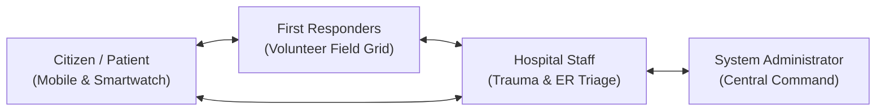

# Emergency Alert and Hospital Assistance System

### Full-Stack Healthcare SaaS Platform: Java Spring Boot Backend + React TypeScript Frontend

**Official Project Name:** Emergency Alert and Hospital Assistance System  
**Project Type:** Community Service Project (CSP)  
**Academic Programme:** Bachelor of Technology (B.Tech)  
**Institution:** Vasireddy Venkatadri Institute of Technology (VVIT), Guntur, Andhra Pradesh  
**Department:** Computer Science and Engineering  
**Batch:** Batch 8  
**Prepared by:** VSK (Reg. No: 24BQ1A054O)  
**Project Guide:** Mr. G. Lakshmi Narayana (Assistant Professor)  

**Live Production Deployments:**
- **Web App (Vercel):** [https://emergency-alert-and-hospital-assistance-system.vercel.app](https://emergency-alert-and-hospital-assistance-system.vercel.app)
- **Backend API (Render):** [https://emergency-alert-and-hospital-assistance.onrender.com](https://emergency-alert-and-hospital-assistance.onrender.com)
- **Interactive API Documentation (Swagger UI):** [https://emergency-alert-and-hospital-assistance.onrender.com/swagger-ui.html](https://emergency-alert-and-hospital-assistance.onrender.com/swagger-ui.html)

---

## 1. Executive Summary & Project Purpose

During acute medical crises and vehicular accidents, victims frequently suffer from critical communication latency when attempting to notify emergency transport teams and receiving hospitals. Trauma centers often receive casualties with zero advance notice, preventing emergency departments from pre-allocating surgical suites, intensive care beds, and cross-matched blood supplies.

The **Emergency Alert and Hospital Assistance System** establishes a real-time, synchronized emergency response network bridging four vital healthcare stakeholders:



$$\text{Citizen / Patient} \longleftrightarrow \text{First Responders} \longleftrightarrow \text{Hospital Staff} \longleftrightarrow \text{System Administrator}$$

---

## 2. Technical Architecture & Tech Stack

The platform is designed around a decoupled, secure client-server architecture with strict role-based access control (RBAC):

```
Smartwatch (Wear OS) ──> Mobile App (Flutter) ──> Spring Boot REST API ──> Supabase PostgreSQL (Port 5432)
                                                         ▲
React Web App (Vite SaaS) ──────────────────────────────┘
```

| Layer | Technologies & Frameworks | Description & Versioning |
| :--- | :--- | :--- |
| **Frontend Web App** | React 19, TypeScript, Tailwind CSS v4, Vite 8, Zustand, Lucide React, Leaflet, Recharts | Clinical-grade healthcare SaaS with Light/Dark themes and 4 role dashboards |
| **Backend REST API** | Java 21 LTS, Spring Boot 3.3.4, Spring Security, Spring Data JPA, JJWT 0.12.5, SpringDoc OpenAPI 2.6.0 | Stateless microservices, Haversine geospatial proximity engine, SSE streams |
| **Production Database** | Supabase PostgreSQL 17.11 (Session Pooler via JDBC on port 5432) | Relational persistence with 12 normalized tables, strict Flyway schema migrations |
| **Development Database** | In-Memory H2 Database (`SPRING_PROFILES_ACTIVE=dev`) | Zero-config local development and integration testing |
| **Mobile Client** | Flutter 3 (Dart), `flutter_map`, OpenStreetMap | Citizen emergency companion with offline first-aid guides and sync engine |
| **Smartwatch Client** | Wear OS (Kotlin), Android SDK, Hardware IMU Sensors | Real-time 50Hz accelerometer and gyroscope accident detection pipeline |

---

## 3. Repository Architecture

In accordance with deployment requirements, the version-controlled repository tracks the core cloud application modules (`Backend/` and `Web App/`):

```
emergency-alert-and-hospital-assistance-system/
|-- Backend/                        # Java Spring Boot Backend (Java 21 LTS, Spring Boot 3.3.4)
|   |-- src/main/java/.../emergency/
|   |   |-- controller/             # REST controllers (/api/v1/auth, /emergencies, /hospitals, /admin)
|   |   |-- service/                # Proximity engine, notification fanout, SSE stream broadcasts
|   |   |-- repository/             # Spring Data JPA interfaces (12 repositories)
|   |   |-- model/                  # JPA entities (User, Incident, Hospital, Responder, Expense, etc.)
|   |   |-- security/               # JWT authentication filter, BCrypt password hashing
|   |   `-- config/                 # SecurityConfig, CorsConfig, OpenAPI, DataInitializer (dev only)
|   |-- src/main/resources/
|   |   |-- db/migration/           # Flyway SQL migrations (V1__initial_schema.sql, V2__constraints.sql)
|   |   |-- application.properties  # Shared configuration and CORS whitelist
|   |   `-- application-postgres.properties # Supabase PostgreSQL production configuration
|   |-- Dockerfile                  # Production container definition for Render cloud deployment
|   `-- pom.xml                     # Maven project configuration and dependencies
|
|-- Web App/                        # React TypeScript Single Page Application (Vite 8, Tailwind v4)
|   |-- src/
|   |   |-- api/                    # Axios clients with automatic JWT bearer interceptors
|   |   |-- components/             # Reusable UI components, Modals, Navbar, Sidebar, Leaflet Map
|   |   |-- layouts/                # MainLayout with responsive sidebar and role-tailored navigation
|   |   |-- pages/                  # Four dedicated role dashboards (Admin, Hospital, Responder, Citizen)
|   |   |-- store/                  # Zustand state stores (Auth, Emergency, Hospital, Notification, Theme)
|   |   `-- types/                  # Domain TypeScript interfaces and API schemas
|   |-- public/                     # Healthcare branding assets, SVGs, and PWA manifest
|   |-- vercel.json                 # Vercel SPA routing and reverse-proxy configuration
|   |-- vite.config.ts              # Vite bundler configuration
|   `-- package.json                # NPM build scripts and dependencies
|
|-- render.yaml                     # Render Infrastructure-as-Code deployment blueprint
`-- README.md                       # Comprehensive platform documentation
```

*Note: Companion client modules (`Mobile App/` and `Smart Watch App/`) are maintained locally for hardware testing and sensor calibration.*

---

## 4. Implemented Features & Core Capabilities

### 1. React Web Application (Full-Stack Healthcare SaaS)
- **Role-Based Portals:**
  - **Citizen / Patient (`/citizen`):** Reassuring emergency tracking portal, active incident status, verified Digital Medical ID with voluntary allergy/blood group management, emergency contact cards, and read-only hospital directory.
  - **Hospital Staff (`/hospital`):** Emergency Department triage command, inbound casualty feed with clinical severity, 1-click Accept/Decline triage modals, trauma bay preparation checkpoints, and live bed/ICU capacity management.
  - **First Responder (`/responder`):** Field volunteer dispatch console with duty status toggle (`AVAILABLE` / `OFF_DUTY`), GPS location synchronization, nearby unclaimed incident radar, and turn-by-turn routing via OpenStreetMap.
  - **System Administrator (`/admin`):** System-wide incident grid counter, live incident triage feed, Wear OS telemetry status, ambulance fleet monitor, interactive Leaflet GIS dispatch map with category filters, and audit logs.
- **Clinical AI Triage Assistant (`/ai-triage`):** Emergency medical handoff dossier generator powered by Google Gemini 1.5 Flash with deterministic, clinical rule-based emergency triage fallback.
- **Dual-Theme Design System:** Clinical Light Mode default with an instant Dark Mode toggle, built with accessible WCAG 2.1 AA contrast ratios.
- **Dual-Mode Authentication:** Secure institutional email/password authentication alongside SMS/Phone OTP authentication for citizens.

### 2. Java Spring Boot Backend API
- **Stateless RESTful Architecture:** Production-ready endpoints documented via OpenAPI 3 / Swagger UI (`/swagger-ui.html`).
- **Enterprise Security:** Spring Security filter chain with BCrypt password hashing and HMAC-SHA256 JWT bearer token authentication. Startup validation strictly enforces $\ge 256$-bit keys in production.
- **Supabase PostgreSQL & Flyway:** Clean schema evolution across 12 relational entities (`users`, `hospitals`, `responders`, `user_devices`, `emergency_contacts`, `emergency_incidents`, `ambulances`, `detection_events`, `notification_attempts`, `medical_expenses`, `synchronization_records`, `audit_logs`) with strict Hibernate schema validation (`ddl-auto=validate`).
- **Haversine Proximity Engine:** Computes real-time great-circle distances to rank and route incidents to the closest emergency trauma facilities (e.g., AIIMS Mangalagiri, Manipal Hospital Vijayawada, GGH Guntur).
- **Real-Time Event Streaming:** Server-Sent Events (SSE) broadcast stream (`/api/v1/emergencies/stream`) keeping web dashboards updated with sub-second incident alerts.

### 3. Flutter Mobile Application (Companion Citizen Client)
- **Emergency Companion:** Prominent one-tap manual SOS trigger for critical situations.
- **Offline First-Aid Directory:** Instant access to 10 life-threatening emergency step-by-step guides (CPR, Severe Bleeding, Burns, Choking, Seizures, Fractures) complying with Red Cross and WHO guidelines.
- **Durable Local Storage:** SQLite/shared persistence for contacts and medical profiles before network transmission.
- **Sync Engine:** Background synchronization of buffered incidents using idempotency keys.

### 4. Native Wear OS Smartwatch Application (Companion Wearable Client)
- **High-Frequency Sensor Processing:** Continuous 50Hz sampling of watch 3-axis accelerometer and gyroscope sensors.
- **Accident Detection Pipeline (`FallDetector.kt`):** Evaluates vector impact magnitude $\ge 2.8\text{g}$, rotational angular velocity $\ge 2.5\text{ rad/s}$, and post-impact immobility window ($\ge 2000\text{ms}$).
- **False-Alarm Mitigation:** 10-second countdown with haptic vibration pulses and a prominent cancellation trigger before dispatching alerts.

---

## 5. Verification & Test Execution Summary

All active codebase components were compiled and verified through automated test suites and build pipelines:

| Module | Verification Target | Test / Build Suite | Status | Details |
| :--- | :--- | :--- | :--- | :--- |
| **Backend** | Database & Schema Validation | `FlywayMigrationAndSchemaValidationTest` | **PASSED** | 2 tests passed; verified Flyway migrations, Hibernate validation, entity cascading, and decimal precision |
| **Backend** | Security & Token Lifecycle | `JwtAndSecurityConfigTest` | **PASSED** | 2 tests passed; verified JWT generation, claims parsing, expiration, and BCrypt password encryption |
| **Backend** | End-to-End Workflow | `EmergencyWorkflowIntegrationTest` | **PASSED** | 1 test passed; verified citizen registration, proximity hospital queries, incident creation, and triage queues |
| **Web App** | Frontend Compilation | `tsc -b && vite build` | **PASSED** | 2,771 modules transformed with zero TypeScript or bundling errors; production bundle generated |

*Execution command:*
```bash
# Backend verification:
cd Backend && mvn clean test

# Web App verification:
cd "Web App" && npm run build
```

---

## 6. Quick Start & Execution Guide

### Prerequisites
- Java Development Kit (JDK) 21 LTS
- Node.js 18+ and npm
- Apache Maven 3.9+

### 1. Launching the Backend (Spring Boot)
```bash
cd Backend
# Run with local H2 in-memory profile:
mvn spring-boot:run -Dspring-boot.run.profiles=dev

# Or run with Supabase PostgreSQL profile:
mvn spring-boot:run -Dspring-boot.run.profiles=postgres
```
- API Base URL: `http://localhost:8080/api/v1`
- Swagger UI Documentation: `http://localhost:8080/swagger-ui.html`

### 2. Launching the Web App (React + Vite)
```bash
cd "Web App"
npm install
npm run dev
```
- Local Web Platform: `http://localhost:5173`

---

## 7. Safety, Simulation & Project Scope

- **Emergency Simulation Mode:** This platform operates in educational simulation mode. It does not contact public emergency telephone lines (108/112) or dispatch state government ambulances.
- **Hardware Integration Status:** The Wear OS sensor detection algorithms have been validated through Wear OS emulators and sensor replay test harnesses. Deployment to physical watch hardware remains a field validation task.
- **Web App Architectural Role:** The React Web App serves as a centralized hospital coordination, triage dispatch, and emergency monitoring dashboard. In alignment with real-world medical systems, manual emergency SOS initiation is restricted to personal mobile and smartwatch hardware devices.
